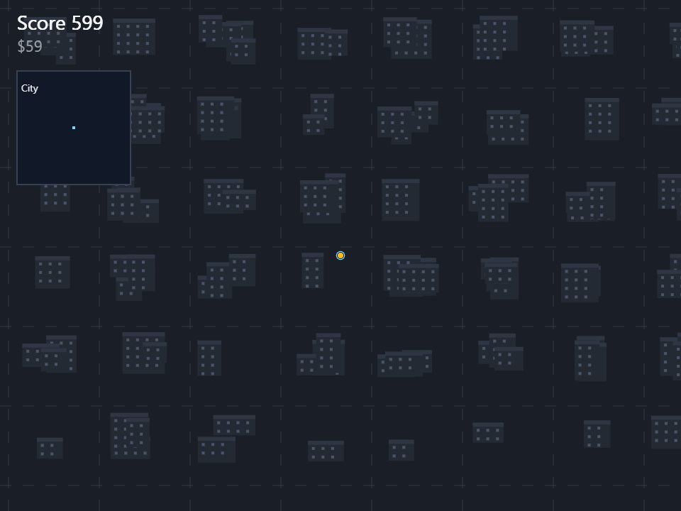

# gta6-01 — Open-World Crime Game

Authored by Agent A during the recorded make.fun gta6-01 session. All game source under `game/` was written in the recorded session.

A complete, original open-world crime game in the spirit of GTA 6, built as static browser files under `game/`. A city to explore on foot and by car, traffic and pedestrians, cars to steal and drive, a wanted level with police who respond, missions, a HUD with a minimap, a start screen, and a save system. No network, no build step, Node 22 entrypoint.

## Features

- **Open World**: Procedural city with 108 blocks (12x9 grid), buildings, and road network
- **Vehicles**: 16 cars including player car, 15 traffic cars with AI navigation
- **Police System**: 10 police units, wanted level 1-5 with escalating response
- **Missions**: 4 mission types (reach, evade, drive, survive) with dynamic objectives
- **HUD**: Score, wanted level with stars, cash, car health bar, minimap with player/traffic/police
- **Save/Load**: Press K to save, L to load game state (slot 1)
- **Screenshot System**: Deterministic autopilot for `?shot=start|play|end&seed=N`

## Screenshots




## make.fun badges


## Build and run

```
mkdir -p out && MAKEFUN_OUTPUT_DIR=out node main.ts
```

The entrypoint copies `game/` and `screenshots/` to `/output` and writes `/output/dossier.json` via `vendor/makefun-game.ts`.

## Controls

| Key | Action |
|-----|--------|
| WASD / Arrows | Move / Drive |
| E | Enter / Exit nearest car |
| K | Save game (slot 1) |
| L | Load game (slot 1) |
| P / Escape | Pause / Resume |
| Space / Enter | Confirm / Start game |

## License

MIT
