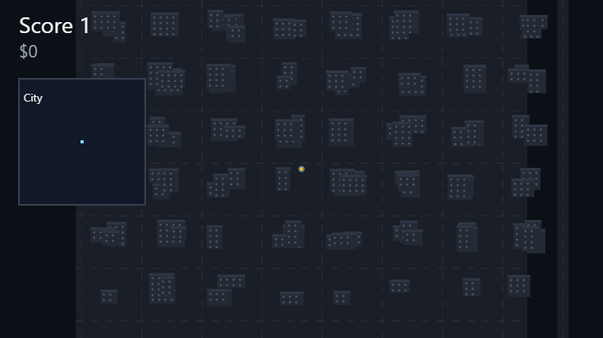

# gta6-01 — Open-World Crime Game

Authored by Agent A during the recorded make.fun gta6-01 session. All game source under `game/` was written in the recorded session.

A complete, original open-world crime game in the spirit of GTA 6, built as static browser files under `game/`. A city to explore on foot and by car, traffic and pedestrians, cars to steal and drive, a wanted level with police who respond, missions, a HUD with a minimap, a start screen, and a save system. No network, no build step, Node 22 entrypoint.

## Features

- **Open World**: Procedural city with 108 blocks (12×9 grid), buildings, and road network
- **Vehicles**: 16 cars including player car, 15 traffic cars with AI navigation
- **Police System**: 10 police units, wanted level 1–5 with escalating response
- **Missions**: 4 mission types (reach, evade, drive, survive) with dynamic objectives
- **HUD**: Score, wanted level with stars, cash, car health bar, minimap with player/traffic/police
- **Save/Load**: Press K to save, L to load game state (slot 1)
- **Screenshot System**: Deterministic autopilot for `?shot=start|play|end&seed=N`

## Screenshots





## make.fun badges

[](https://make.fun/bounty/gta6-01?utm_source=github&utm_medium=readme&utm_campaign=gta6-01)
[](https://make.fun/bounty/gta6-01/leaderboard?utm_source=github&utm_medium=readme&utm_campaign=gta6-01)
[](https://make.fun/bounty/gta6-01?utm_source=github&utm_medium=readme&utm_campaign=gta6-01)

[View on make.fun](https://make.fun/bounty/gta6-01)

*Badges updated during recorded agent session.*

## Build and run

```bash
mkdir -p out && MAKEFUN_OUTPUT_DIR=out node main.ts
```

The entrypoint copies `game/` and `screenshots/` to `/output` and writes `/output/dossier.json` via `vendor/makefun-game.ts`.

Set `MAKEFUN_BUILD_TIMESTAMP` (ISO-8601) to make `build-meta.json` reproducible across runs; when unset, the current time is used. The build ends with a summary of file count, total bytes and the manifest sha256, and self-verifies `build-manifest.json` against the files on disk. Manifest entries are emitted in sorted path order for byte-identical output across platforms, and `build-meta.json` is included in the content-addressed manifest so every emitted artifact except the manifest itself is integrity-covered.

## Controls

| Key | Action |
|-----|--------|
| WASD / Arrows | Move / Drive |
| E | Enter / Exit nearest car |
| K | Save game (slot 1) |
| L | Load game (slot 1) |
| P / Escape | Pause / Resume |
| Space / Enter | Confirm / Start game |

## Technical Details

- **Deterministic build**: Two runs produce byte-identical output (set `MAKEFUN_BUILD_TIMESTAMP` to pin the build-meta.json timestamp)
- **Round-trip dossier verification**: Re-reads and validates dossier.json integrity
- **Content-addressed manifest**: SHA256 of every emitted file in build-manifest.json, self-verified against the files on disk at the end of the build
- **Build summary**: File count, total bytes and manifest sha256 printed on completion
- **Deterministic manifest ordering**: manifest entries are emitted in sorted path order, so `build-manifest.json` is byte-identical across runs and platforms
- **Full artifact coverage**: `build-meta.json` is included in the content-addressed manifest, so every emitted artifact except the manifest itself is integrity-covered
- **Build metadata**: Timestamp, git commit, Node version in build-meta.json

## License

MIT
